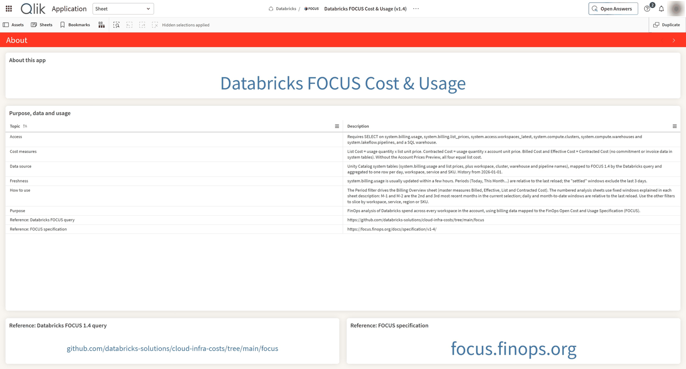
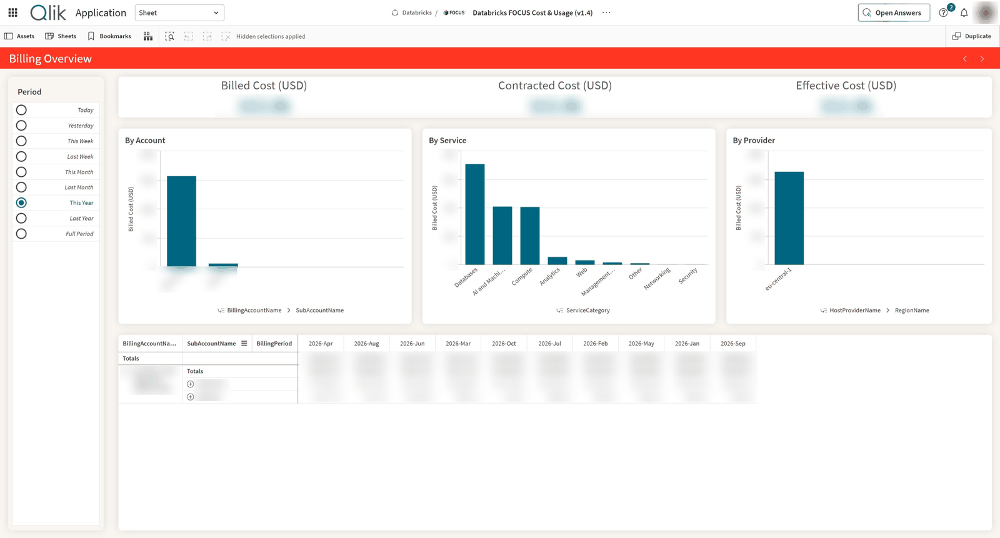
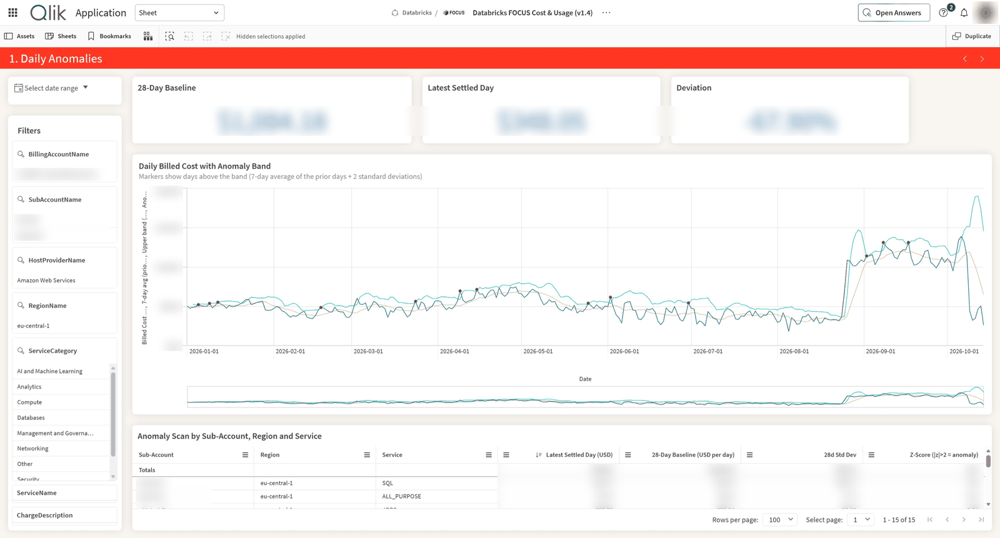
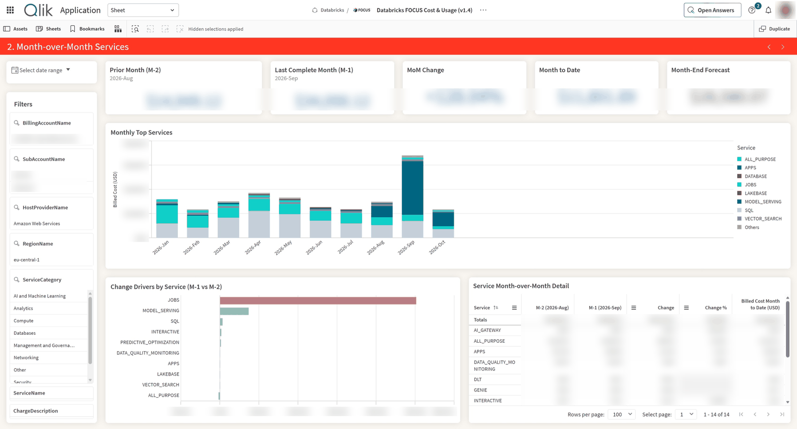
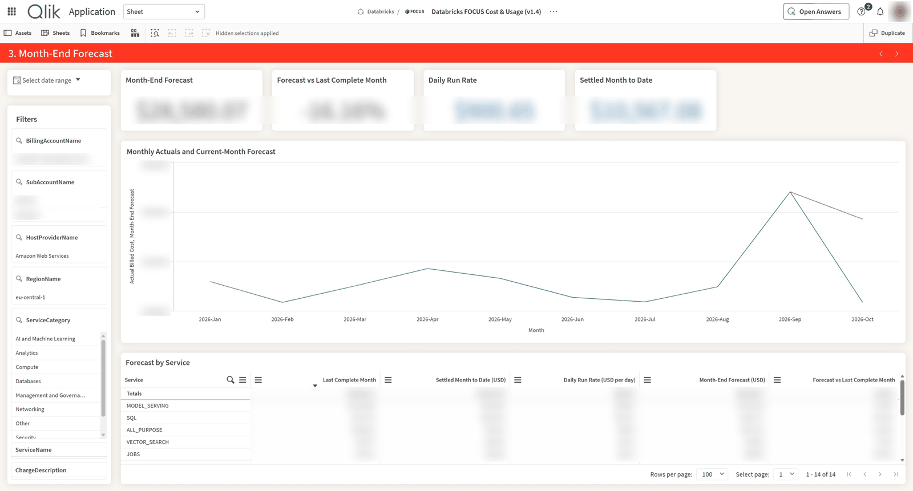
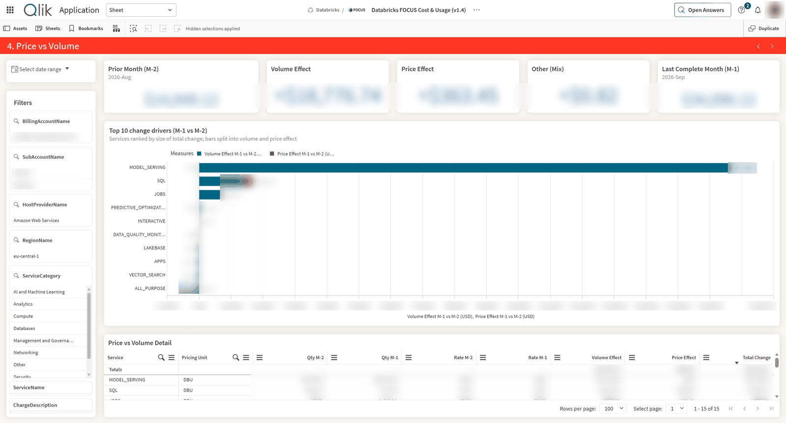
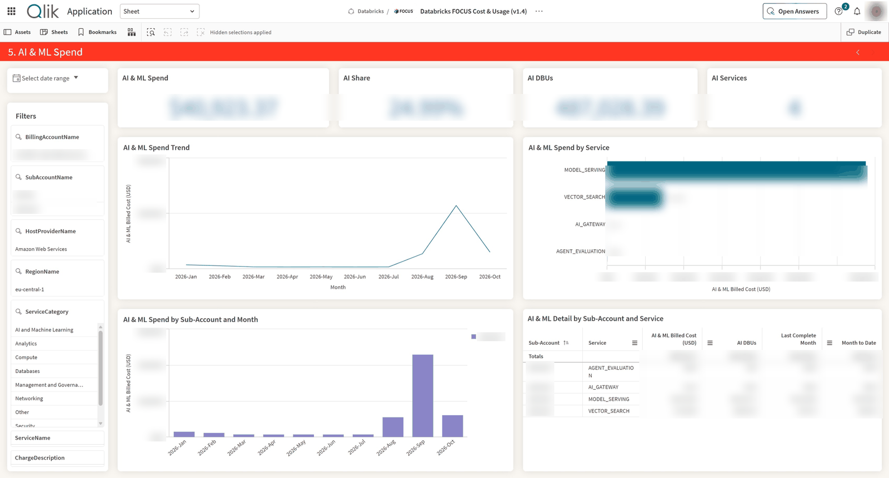

# FinOps: Databricks FOCUS Cost & Usage for Qlik Cloud

A Qlik Cloud Analytics app that monitors Databricks consumption and spend across every workspace in a Databricks account, using billing data mapped to the [FOCUS™](https://focus.finops.org/docs/specification/v1-4/) (FinOps Open Cost & Usage Specification) v1.4 format. It is the Databricks counterpart of the Snowflake FOCUS Cost & Usage app: same sheets, master measures and conventions, so the two can be compared side by side. Paired with Qlik's Discovery Agent, it detects cost anomalies after each reload.

## What is here

| File | What it is |
|---|---|
| `databricks-focus-cost-usage.qvf` | The "Databricks FOCUS Cost & Usage (v1.4)" app, exported **without data**: load script, sheets, charts, master items, variables and thumbnails. |
| `LICENSE-databricks.md`, `NOTICE-databricks.md` | The Databricks License and notice that cover the modified copy of the Databricks FOCUS query in the app's load script. |

## How the data is built

There is no ready-made FOCUS view in Databricks. Databricks publishes a [mapping query](https://github.com/databricks-solutions/cloud-infra-costs/tree/main/focus) that turns Unity Catalog system tables into a FOCUS dataset:

- `system.billing.usage` (usage records)
- `system.billing.list_prices` (or `system.billing.account_prices` in the Account Prices Preview)
- `system.access.workspaces_latest`, `system.compute.clusters`, `system.compute.warehouses`, `system.lakeflow.pipelines` (names)

The load script runs that query with three changes:

1. The CTEs are wrapped in a subquery, because the Qlik ODBC connector only accepts statements that start with `SELECT`.
2. `:account_prices` is set to `system.billing.list_prices`, and usage is filtered from 2026-01-01.
3. Usage windows are aggregated to one row per day, workspace, service, SKU and unit, the same daily grain as the Snowflake app.

## What the app covers

- **Allocation**: spend by workspace (sub-account), service category, service (Databricks product), SKU, resource type and provider.
- **Reporting and analytics**: daily and monthly trends, sliceable across every FOCUS dimension.
- **Anomaly management**: statistical outliers by day and service, plus Discovery Agent insights.
- **Forecasting**: month-end projection from the settled month to date and the 7-day run rate.
- **Rate tracking**: price vs volume split per service and pricing unit.

### Sheets

| Sheet | What it answers | Time window |
|---|---|---|
| About | Purpose, data source, freshness, cost definitions, access requirements | — |
| Billing Overview | Billed, Contracted and Effective Cost by account, service and provider | The Period selector (today, last week, this year, …) |
| 1. Daily Anomalies | Which days and services spent unusually (7-day average + 2σ band; z-score per workspace, region and service, \|z\| > 2 flagged) | Latest settled day (3 days before reload) vs the 28 days before it |
| 2. Month-over-Month Services | How service costs changed month over month | M-1 vs M-2, plus month to date and forecast |
| 3. Month-End Forecast | Where the current month will land | Settled month to date + 7-day run rate × remaining days |
| 4. Price vs Volume | Whether a change came from usage (volume), rates (price) or new/dropped services (mix) | M-1 vs M-2 |
| 5. AI & ML Spend | What Model Serving, Vector Search, AI Functions, AI Gateway, Agent Bricks and other AI products cost: spend, share, DBUs, services | Current selections |

M-1 and M-2 are the 2nd and 3rd most recent months in the current selection (variables `vSAM-1`/`vSAM-2`). With nothing selected, they are the last complete month and the month before. Rates are always calculated per pricing unit, so different units are never mixed.

<details>
<summary>Sheet screenshots</summary>

**About**



**Billing Overview**



**1. Daily Anomalies**



**2. Month-over-Month Services**



**3. Month-End Forecast**



**4. Price vs Volume**



**5. AI & ML Spend**



Values are blurred.

</details>

### Cost measures

| Measure | Meaning in this mapping |
|---|---|
| List Cost | Usage quantity × list unit price |
| Contracted Cost | Usage quantity × account unit price |
| Billed Cost | Same as Contracted Cost |
| Effective Cost | Same as Billed Cost (no commitment or savings-plan data in system tables) |

Outside the Account Prices Preview, the account price comes from `list_prices` too, so all four costs equal list cost: they show list-price consumption, not your invoice. All costs are in USD.

## Prerequisites

- A Qlik Cloud Analytics tenant (Discovery Agent is optional).
- A Databricks workspace with Unity Catalog and system tables enabled (`system.billing` is on by default; `access`, `compute` and `lakeflow` may need enabling by an account admin).
- A SQL warehouse (serverless or pro; a small size is enough).
- A dedicated service principal for Qlik, granted:

  ```sql
  GRANT USE CATALOG ON CATALOG system TO `<qlik-service-principal>`;
  GRANT USE SCHEMA ON SCHEMA system.billing   TO `<qlik-service-principal>`;
  GRANT USE SCHEMA ON SCHEMA system.access    TO `<qlik-service-principal>`;
  GRANT USE SCHEMA ON SCHEMA system.compute   TO `<qlik-service-principal>`;
  GRANT USE SCHEMA ON SCHEMA system.lakeflow  TO `<qlik-service-principal>`;
  GRANT SELECT ON TABLE system.billing.usage             TO `<qlik-service-principal>`;
  GRANT SELECT ON TABLE system.billing.list_prices       TO `<qlik-service-principal>`;
  GRANT SELECT ON TABLE system.access.workspaces_latest  TO `<qlik-service-principal>`;
  GRANT SELECT ON TABLE system.compute.clusters          TO `<qlik-service-principal>`;
  GRANT SELECT ON TABLE system.compute.warehouses        TO `<qlik-service-principal>`;
  GRANT SELECT ON TABLE system.lakeflow.pipelines        TO `<qlik-service-principal>`;
  ```

  plus `CAN USE` on the SQL warehouse. Check access by running the [Databricks FOCUS 1.4 query](https://github.com/databricks-solutions/cloud-infra-costs/tree/main/focus) in the SQL editor as that principal.

## Installing

### 1. Upload the app

1. In Qlik Cloud, go to **Create → Upload app** and choose `databricks-focus-cost-usage.qvf`. It contains the load script, sheets, master items, variables and thumbnails, but no data.
2. Pick a shared space (for example `Databricks`) where you can create data connections. The connection must be in the same space, or in a space the app can read.

Don't reload yet: the connection the script refers to doesn't exist in your tenant.

### 2. Create the Databricks connection

1. Open the app's **Data load editor** and click **Create new connection → Databricks**.
2. Fill in:

   | Setting | Value |
   |---|---|
   | Host | `<workspace>.azuredatabricks.net`, `<workspace>.cloud.databricks.com` or `<workspace>.gcp.databricks.com` |
   | Port | `443` |
   | HTTP path | The SQL warehouse's HTTP path (warehouse → **Connection details**) |
   | Catalog / Schema | `system` / `billing` |
   | Authentication | OAuth M2M for the service principal (recommended) or a personal access token of the service principal |

3. Name it, click **Test connection**, then **Create**.

Avoid a personal user or token: a service principal with only the grants above keeps billing access narrow.

### 3. Update the load script

The script is already in the app; only the connection line needs changing.

1. In **Data load editor**, open the **Main** tab and find:

   ```qlik
   LIB CONNECT TO 'Databricks:Databricks_PE_DEMO__Warehouse';
   ```

2. Change it to `'<SpaceName>:<ConnectionName>'` for your connection, or just the name for a personal-space connection. The connection's **Connect** (plug) icon in the Data connections panel inserts the exact string.
3. Optional changes on the **FOCUS Cost & Usage** tab:
   - In the Account Prices Preview (AWS/GCP), change the table in the `account_prices` CTE to `system.billing.account_prices`.
   - Change `usage_date >= DATE'2026-01-01'` to load more or less history.
4. Don't change the column names in the final `SELECT`: the sheets and master measures depend on them.
5. Click **Load data**.

If the reload fails:

| Error | Cause |
|---|---|
| `Executing non-SELECT queries is disabled` | The statement starts with `WITH`; use the script as provided, which wraps the CTEs in a `SELECT` |
| `Invalid authentication` / `Access credentials are not valid` | The connection's token or OAuth secret is wrong or expired; edit the connection credentials |
| `TABLE_OR_VIEW_NOT_FOUND` / `PERMISSION_DENIED` on a `system.*` table | The system schema isn't enabled, or the principal lacks the grants above |

### 4. Validate and schedule

1. Compare Billed Cost for a closed month with the account console's usage page (at list price, unless you use account prices).
2. Schedule a daily reload.

### Optional: Discovery Agent

In the Qlik Cloud Administration console, enable cross-region data processing and assign the Discovery Agent role to the users who should receive insights. Then enable Discovery Agent on the app and create a trigger group on Billed Cost (USD) with time dimension `BillingPeriod`, broken down by `SubAccountName`, `ServiceName` and `ChargeDescription`.

## Resources

- [Databricks FOCUS mapping query](https://github.com/databricks-solutions/cloud-infra-costs/tree/main/focus)
- [Databricks billable usage system table](https://docs.databricks.com/aws/en/admin/system-tables/billing)
- [Qlik Discovery Agent documentation](https://help.qlik.com/en-US/cloud-services/Subsystems/Hub/Content/Sense_Hub/DiscoveryAgent/discovery-agent.htm)
- [FOCUS specification](https://focus.finops.org)

## License

- The SQL in the app's load script (inside `databricks-focus-cost-usage.qvf`), a modified copy of the Databricks FOCUS 1.4 query with the changes listed in the script header, is Copyright (2025) Databricks, Inc., under the [Databricks License](LICENSE-databricks.md); see also [NOTICE-databricks.md](NOTICE-databricks.md). That license only permits use in connection with the Databricks Services.
- Everything else in this repository is under the Apache 2.0 [LICENSE](../LICENSE).

FOCUS™ is a trademark of the FinOps Foundation.
